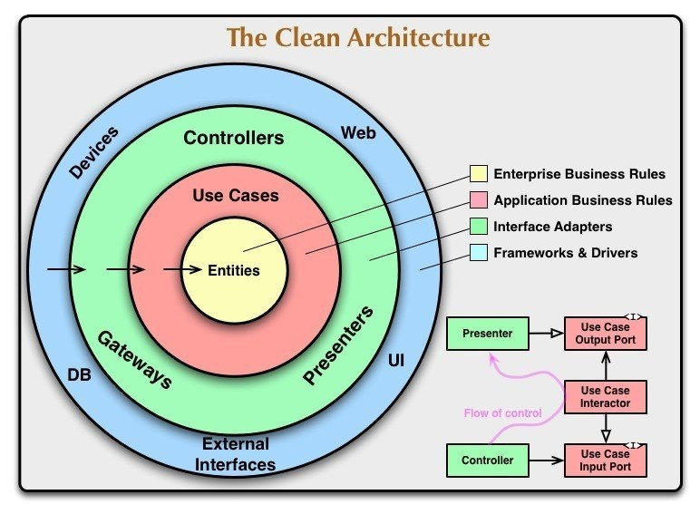
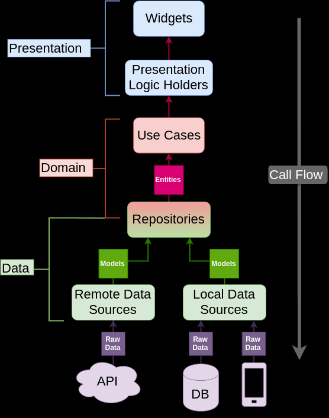

### Contents:

1. Model View Controller
2. Layered architecture, and Clean vs Layered
3. Clean Architecture
4. How the three relate
5. Clean architecture in Flutter

---

## 1. Model View Controller

- MVC is a design pattern that separates an application into Model, View, and Controller.
- The Model manages data, business rules, and application logic.
- Models are typically defined using Mongoose, which maps MongoDB documents to JavaScript objects.
- The Model handles database operations like CRUD, schema validation, and business logic.
- MongoDB’s schema-less nature fits well with MVC, allowing flexible model evolution.
- Mongoose brings a schema back on the application side, so the flexibility is a choice, not the default.
- The same Model can be reused for multiple Views, such as web pages and API responses.
- The View is responsible only for presenting data to the user.
- Views are built using HTML and CSS, often with templating engines like EJS or Handlebars.
- Client-side JavaScript enhances the View with dynamic behavior and DOM manipulation.
- The Controller handles user input and coordinates between the Model and View.
- Controllers receive requests from the frontend, process data, and return responses or rendered views.
- In a Node.js application, Express handles routes and HTTP requests, and the Controller layer is the route handler (controller) functions you write on top of it.
- Middleware in Express integrates smoothly with MVC for authentication, logging, and validation.
- MVC helps keep routing logic separate from database queries, improving maintainability.
- Using MVC in Express makes APIs cleaner and more modular, especially for RESTful services.
- This separation improves code organization and readability.
- MVC makes applications easier to maintain and scale, making it easier to add new features or endpoints.
- Overall, MVC enables a clean code structure, faster development, and easier collaboration.

### MVC in practice:

- Request flow: Client => Route => Controller => Model => Database, then the Controller picks the View (rendered HTML) or sends JSON.
- In a REST API there is no HTML View. The JSON response is the View.
- Typical folders: `models/`, `views/`, `controllers/`, `routes/`.
- MVC has no separate service layer. Business logic ends up in the Model or the Controller. Layered architecture (section 2) adds that layer.

---

## 2. Layered architecture:

- Separation of concerns.
- Horizontal layers each with clear responsibility.
- Request and response pass from one layer to next.
- Typical 3-layer architecture: Presentation layer => Business / Domain Layer => Data Layer. Layers are logical groups of code. Tiers are physical deployments (client, app server, database server). This is a 3-layer architecture.
- Request flow (top to bottom) => Client => Controller => Service => Repository => Database <= Response flow (bottom to top)

### LAYERS:

1. Presentation Layer (Controller / API)
2. Application / Service / Domain Layer (Business Logic)
3. Data Access / Persistence / Infrastructure Layer (Repository / DAO)
4. Database

### COMPONENTS

Controller:

- Handles HTTP request/response, input validation, routing.
- Serialization (Object => JSON) and Deserialization (JSON => Object) happens at the controller layer but it’s done by web framework (Express.js, Springboot etc.).
- Converted JSON is then sent to client.

Service:

- Contains business logic, orchestrates multiple repositories.

Repository:

- Contains DB queries, keeping db logic out of controllers or models.
- Fetches and persists data without exposing database details.
- Once we get data from DB, it is plugged in as per our model by repository and returned to service.
- Encapsulates all data access logic.

Model:

- Represents data or business concepts in a specific layer.
- Each layer has its own form of model. It represents same data but in different form at different layers.
- Presentation layer - DTO (Data Transfer Object)
- Domain layer (Entity / Business object)
- Data layer (Persistence model - ORM / ODM)

**Controllers handle requests, Services decide what to do, Repositories handle data, and Models carry information between them.**

### Layered architecture in a Node app:

```
src/
  routes/         (maps URLs to controllers)
  controllers/    (Presentation: req and res)
  services/       (Business logic)
  repositories/   (Data access: queries)
  models/         (Mongoose schemas)
  middlewares/
```

- A layer talks only to the layer directly below it.
- No database code in controllers. No `req` or `res` in services.
- Validation of the request shape belongs in the controller or a validation middleware. Business rules belong in the service.

---

### Clean architecture vs Layered architecture:

- Layer arch. has flow from top to bottom, clean arch. has flow from outward to inward.
- Inner layers know nothing about outer layers.
- Business logic is fully independent.
- Main difference is dependency inversion.
- Presentation => Application (Use Cases) => Domain (Entities & Rules) <= Infrastructure (DB, Frameworks)
- In layered architecture the business layer depends on the data layer, so business code ends up depending on the database. In Clean Architecture the data layer depends on the domain instead, so the database can be swapped without touching business rules.

Layers:

1. Presentation Layer (Controller / API)
2. Application Layer (Service / Use Cases)
3. Domain Layer (Entities, Business Logic)
4. Data Access / Persistence / Infrastructure Layer (Repository / DAO)
5. Database

---

## 3. Clean Architecture:

- Software design philosophy by Robert Martin (Uncle Bob).
- Separation of concerns: Build scalable, maintainable, testable applications.
- Dependency rule: Dependencies point inward (Dependency Inversion). Outer layers depend on inner layers, but inner layers should never know anything about outer layers. Loose coupling.
- Domain first, at the center.

LAYERS: Onion architecture (concentric circles)

1. Layer 1 - Frameworks & Drivers (outermost)
2. Layer 2 - Interface Adapters
3. Layer 3 - Use Cases (Application Business Rules)
4. Layer 4 - Entities - Enterprise Business Rules (innermost)



### Clean Architecture in a Node app:

| Clean Architecture layer | In a Node and Express app                                                      |
| ------------------------ | ------------------------------------------------------------------------------ |
| Entities                 | Plain classes with business rules (Invoice, User). No Mongoose, no Express     |
| Use Cases                | One function or class per action (CreateInvoice). Calls a repository interface |
| Interface Adapters       | Controllers, repository implementations, mappers and DTOs                      |
| Frameworks & Drivers     | Express, Mongoose, MongoDB driver, external services                           |

- A use case receives its repository through the constructor (dependency injection). Swapping MongoDB for SQL then changes nothing inside the use case.

---

## 4. How the three relate:

|                         | MVC                               | Layered                                   | Clean                                                         |
| ----------------------- | --------------------------------- | ----------------------------------------- | ------------------------------------------------------------- |
| Splits the app into     | Model, View, Controller           | Controller, Service, Repository, Database | Entities, Use Cases, Interface Adapters, Frameworks & Drivers |
| Dependency direction    | Controller uses Model and View    | Top to bottom                             | Outside to inside                                             |
| Business logic lives in | Model (or Controller)             | Service layer                             | Entities and Use Cases                                        |
| Database knowledge      | In the Model                      | Service depends on the data layer         | Only in the outermost layer                                   |
| Best for                | Small apps, server-rendered pages | Most Node and Express APIs                | Large apps, long-lived, swappable infrastructure              |

---

## 5. Clean Architecture in Flutter:

PROJECT FOLDER STRUCTURE:

lib:

1. core: reusable utilities (network, errors, constants, routes, helpers).
2. features: feature-based modules (login, checkout, payments, etc.).

feature:

1. presentation: Bloc, Pages, Widgets
2. domain: Usecases, Entities, Repositories
3. data: Datasources, Models, Repository Implementations
4. feature-level dependency injection file

PRESENTATION LAYER:

1. Pages: screen-level UI.
2. Widgets: reusable UI components.
3. Bloc: Widgets dispatch events to Bloc and Bloc emits states back to widgets. event => bloc => state

- Bloc calls usecase.
- UI logic stays thin; business logic stays out of widgets.

DOMAIN LAYER:

1. UseCases: single responsibility classes with a call() method.
2. Repositories (abstract): define contracts, return Future\<Either\<Failure, Entity>>.
3. Entities: plain Dart classes representing business objects (no JSON, no framework code).

- Independent of framework.
- Key principle: Domain depends on nothing; everything depends on domain.
- Repositories bridge Domain and Data layers

UseCase Pattern

- Input: Params or NoParams from Bloc.
- Output: Either\<Failure, Entity>.
- Encapsulates one specific business action (e.g., GetUser, Login, FetchOrders).

DATA LAYER:

1. Repository (Implements repository contracts from domain): Convert Models <=> Entities. Handle Left(Failure) and Right(Data) responses.
2. Models: Extend Entities. Contain fromJson, toJson, and factory constructors.
3. Datasources: handle API calls, caching, database access.

Dependency Flow: Presentation => Domain <= Data

Data Flow: UI => Events => BLoC => Use Cases => Repository => Data Sources UI <= States <= BLoC <= Entities <= Repository <= Data Sources



TDD (Test-Driven Development) Workflow:

1. Write tests before implementation.
2. Mirror lib/ structure inside test/.
3. Use Arrange => Act => Assert.
4. Mock dependencies with Mockito.
5. JSON fixtures provide predictable dummy data for tests.

Key Libraries:

1. get_it => dependency injection (service locator).
2. flutter_bloc => state management.
3. equatable => value equality for entities and states.
4. dartz => functional programming (Either, Left, Right).
5. http, data_connection_checker_nulls => remote API handling.
6. shared_preferences => local caching.

Links:

- https://resocoder.com/2019/08/27/flutter-tdd-clean-architecture-course-1-explanation-project-structure/
- https://resocoder.com/2019/08/29/flutter-tdd-clean-architecture-course-2-entities-use-cases/
- https://resocoder.com/2019/09/02/flutter-tdd-clean-architecture-course-3-domain-layer-refactoring/
- https://resocoder.com/2019/09/09/flutter-tdd-clean-architecture-course-4-data-layer-overview-models/
- https://resocoder.com/2019/09/12/flutter-tdd-clean-architecture-course-5-contracts-of-data-sources/
- https://resocoder.com/2019/09/19/flutter-tdd-clean-architecture-course-6-repository-implementation/
- https://resocoder.com/2019/09/23/flutter-tdd-clean-architecture-course-7-network-info/
- https://resocoder.com/2019/09/26/flutter-tdd-clean-architecture-course-8-local-data-source/
- https://resocoder.com/2019/10/03/flutter-tdd-clean-architecture-course-9-remote-data-source/
- https://resocoder.com/2019/10/07/flutter-tdd-clean-architecture-course-10-bloc-scaffolding-input-conversion/
- https://resocoder.com/2019/10/10/flutter-tdd-clean-architecture-course-11-bloc-implementation/
- https://resocoder.com/2019/10/14/flutter-tdd-clean-architecture-course-11-bloc-implementation-2-2/
- https://resocoder.com/2019/10/21/flutter-tdd-clean-architecture-course-13-dependency-injection-user-interface/
- https://resocoder.com/2019/10/29/flutter-tdd-clean-architecture-course-14-user-interface/

Github repo: https://github.com/ResoCoder/flutter-tdd-clean-architecture-course
